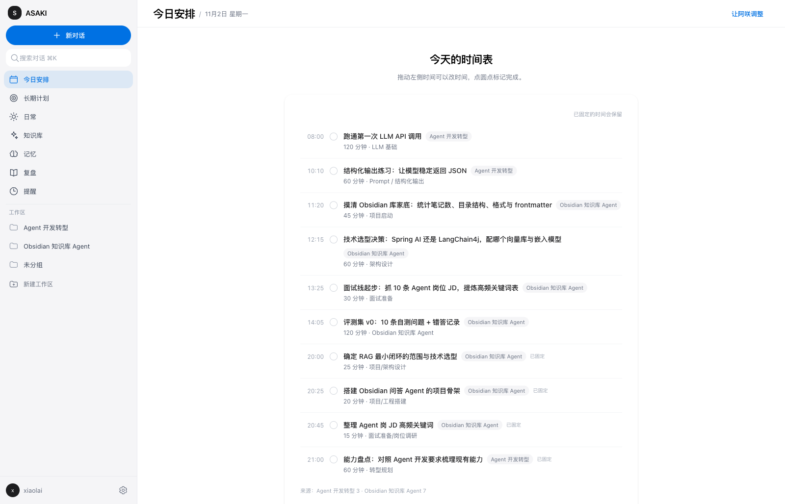
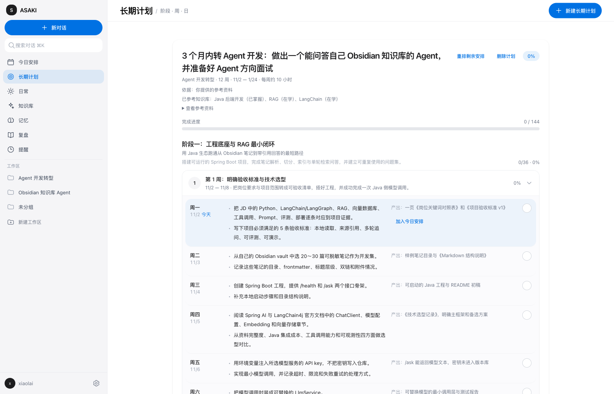
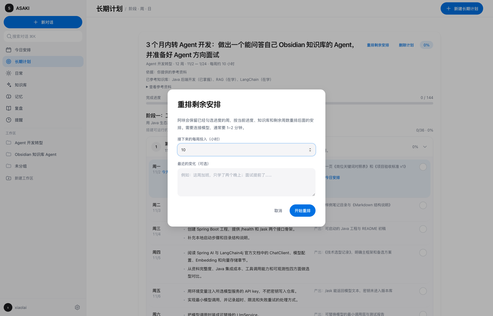
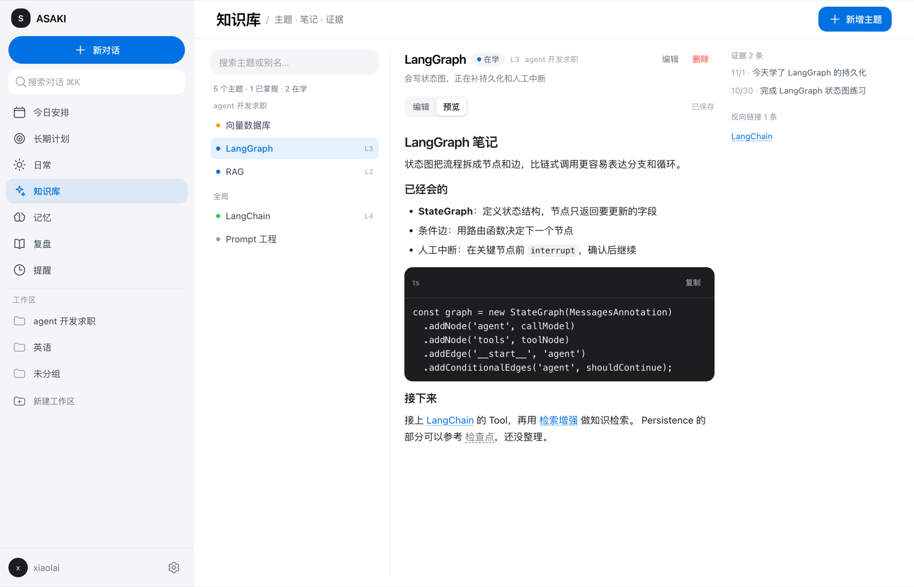
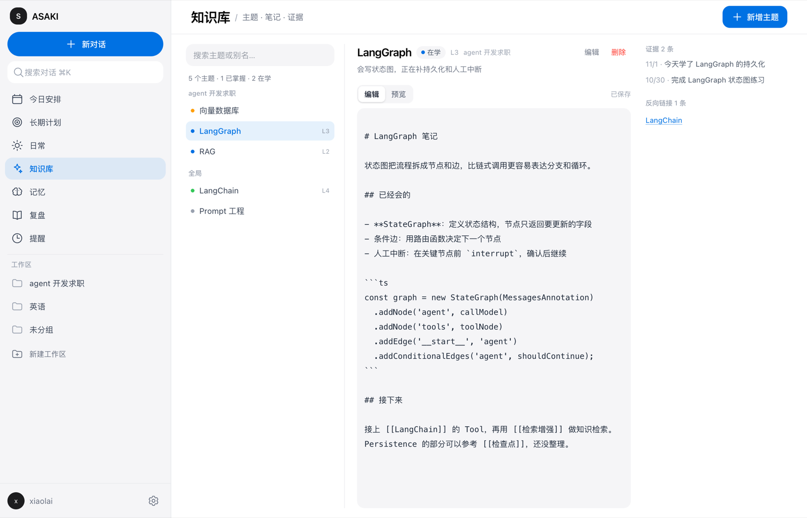
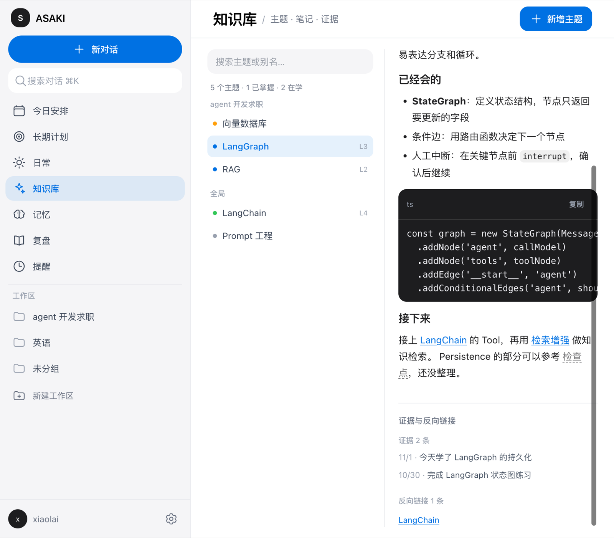
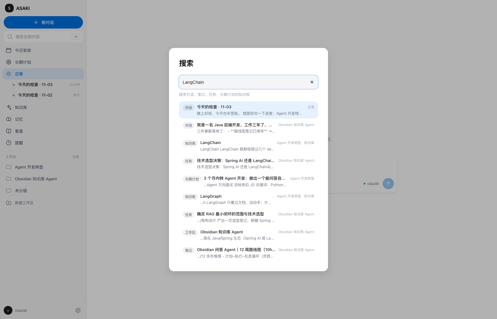

# 阿咲 ASAKI

本地优先的**个人管家与学习工作台**。

它可以当老师、做规划、做记录、做督促。考研只是它服务的一个 workspace，英语、项目、生活同样适用。

- **老师**：讲解、答疑、练习、根据记录指出薄弱点
- **规划**：目标 → 周计划 → 今日任务
- **记录**：笔记、日志、复盘、可见的个人画像
- **督促**：提醒、打卡、连续反馈

所有数据本地优先：无账号、无服务器、无遥测；知识库是纯 markdown，Obsidian 可以直接打开。API key 只进入 Electron `safeStorage`（系统钥匙串），不会写进 vault、日志或测试快照。

## 截图

今日安排把长期计划拆到今天：时间、时长、所属工作区和来源都在一屏。



长期计划按「阶段 → 周 → 日」展开，页面同时显示计划依据、已参考的知识主题和完成进度；进度落后时可以从当前进度重排剩余周次。



重排只覆盖还没开始的周，已经勾选进度的周会原样保留：



知识库把目录、可编辑笔记和证据/反向链接放在同一屏：





窄窗口下，证据与反向链接折叠到笔记下方：



`⌘K` 一次搜索对话、笔记、任务、长期计划和知识库，回车直接跳到对应内容：



## 功能

- **管家**：每日简报、管家对话、建议提问、连续复盘提醒
- **全局搜索**：`⌘K` 统一检索对话、笔记、任务、长期计划和知识库主题/笔记，支持方向键选择并跳转到对应页面
- **长期计划**：按总时长生成「阶段 → 周 → 日」计划；可粘贴参考资料或先联网调研，计划页标注依据来源；勾选每日任务与周验收，可把今天的一行加入今日安排；进度落后时可只重排剩余周次，已有进度的周不会被覆盖；也可直接修改计划目标与每周投入
- **今日安排**：目标、任务列表、完成状态、计时；可手动新增、编辑、删除任务
- **记录**：Obsidian 风格笔记、标签、关联笔记
- **学习**：自建练习题、答题反馈、完整错题本与答题历史
- **复盘**：复盘问题、画像与记忆、督促提醒；可补录过去日期的复盘
- **知识库**：目录 + 可编辑笔记（`knowledge/notes/`），证据自动从任务/笔记/复盘积累，`[[主题名]]` 跳转与反向链接，长期规划据此跳过已学内容；另有无障碍的关系图谱视图；笔记自动保存并检测 Obsidian 等应用的外部修改，冲突时由你选择保留哪一版
- **记忆与提醒**：手动新增记忆并即时更新个人画像；提醒支持工作日/周末重复、编辑、删除与单独开关
- **项目管理**：编辑项目名称、目标与描述；删除项目会移入 `workspaces/.trash/` 以便找回
- **设置**：模型、预算、通知、启动
- **工作区切换**：全部 / 考研 / 英语 / 项目 / 生活

考研是最完整的示例 workspace；英语、项目、生活用来验证“不只是考研”。

## 开发

需要 Node.js 24+。

```bash
npm install
npm run dev        # Electron 桌面应用（真实 main/preload/renderer + 本地 vault）
```

浏览器原型（使用 mock API，不读写真实 vault）：

```bash
npm run dev:web
```

打开终端里打印的地址（默认 `http://localhost:5173`）。

隔离本地数据（可选）：设置 `STUDY_COACH_USER_DATA_DIR` 后，Electron 的 `userData`（`state.json`、密钥）会写到该目录，便于开发时使用一次性 profile。例如：

```bash
STUDY_COACH_USER_DATA_DIR=/tmp/study-coach-dev npm run dev
```

## 测试

```bash
npm run typecheck     # TypeScript strict（main/preload/shared + renderer/web）
npm test              # Vitest：单元 + 集成测试
npm run typecheck:e2e # Playwright e2e 的 TypeScript 检查
npm run test:e2e      # 构建 Electron 产物并运行 Playwright e2e
```

`e2e/**` 用 Playwright 的 `_electron` 启动**真实 Electron 应用**，覆盖 onboarding → 今日安排（写入真实 vault 任务）→ 管家对话。模型层使用仓库内的 fake CLI（`e2e/fixtures/fake-codex.mjs`），不联网、不需要 API key，也不读取真实 CLI 凭据；测试进程会主动移除 `*_API_KEY`、`*_TOKEN`、`*_SECRET` 等环境变量。每个 e2e 使用临时 `userData` 与临时 vault，结束后删除。

单独运行：

```bash
npm run build
npx playwright test --config e2e/playwright.config.ts
```

## 打包

`electron-builder.yml` 配置 macOS arm64 的 `dir`（快速本地验证）、`zip` 和 `dmg`：

```bash
npm run build
npx electron-builder --dir     # 只生成未签名 .app，最快
npm run package                # 同上（build + --dir）
npm run dist                   # build + zip + dmg
```

产物在 `dist/`，例如 `dist/mac-arm64/ASAKI.app`、`dist/ASAKI-1.0.0-arm64.dmg`。

默认不签名，本地没有证书也能构建：

```bash
CSC_IDENTITY_AUTO_DISCOVERY=false npx electron-builder --dir
```

需要签名/分发时，在环境中提供 electron-builder 支持的凭据（如 `CSC_LINK` + `CSC_KEY_PASSWORD`，或钥匙串里的 `CSC_NAME`）；`electron-builder.yml` 已开启 `hardenedRuntime`，未提供凭据时会自动跳过签名。CI 不打包、不接触任何证书。

## 架构

```text
src/
  main/        Electron 主进程
    index.ts      app 生命周期、窗口、scheduler/tray 启动
    ipc.ts        channel 表、handler、错误脱敏、preload bridge
    context.ts    组合 state/settings/secrets/workspace/butler
    workspace/    真实 vault 的读写（markdown + YAML frontmatter）
    planning/     WorkspacePlanner（模型 JSON + 模板回退）
    plans/        长期计划（阶段/周/日生成、勾选进度、vault 持久化）
    practice/     题库、判分、错题、间隔重复
    memory/       复盘 → 记忆 → 画像
    knowledge/    知识主题、证据时间线与自动链接（任务/笔记/复盘）
    agent/        Anthropic/OpenAI-compatible/Ollama + 本地 CLI client
    butler/       管家 prompt、上下文和工具循环
    scheduler/    早间/晚间提醒、免打扰
  preload/     contextBridge 暴露类型化 window.studyCoach
  renderer/    React 19 + Tailwind 工作台 UI
  shared/      主进程 / preload / renderer 共用的契约和纯函数
web/           浏览器原型（mock API，不接触真实数据）
e2e/           Playwright Electron e2e + fake CLI
tests/         Vitest 单元/集成测试
```

**数据流**：renderer 调用 `window.studyCoach.*` → preload 通过 `ipcRenderer.invoke` 走 `study-coach:*` channel → main 的 IPC handler 校验参数 → workspace/butler/settings 服务读写 vault 或返回结果。错误在进入 renderer 前会脱敏（如 `sk-...`），密钥只存在内存和系统加密存储。

**Vault 布局**（纯 markdown，可用 Obsidian 直接打开）：

```text
<vault>/
  workspaces/<id>/workspace.md              workspace 资料（名称、目标、类型）
  workspaces/<id>/tasks/YYYY-MM-DD.md       每日任务
  workspaces/<id>/notes/*.md                笔记
  workspaces/<id>/plans/*.md                长期计划（阶段、周、每日任务、验收）
  workspaces/<id>/memory.md                 管家记忆
  workspaces/<id>/reviews/YYYY-MM-DD.md     按 workspace 的复盘
  reviews/YYYY-MM-DD.md                     vault 级复盘
  knowledge/topics/*.md                     知识主题（全局或按 workspace，含证据）
  reminders.md                              全局提醒
```

frontmatter 是机器可读的事实源，正文是给人看的渲染；索引可以随时重建。默认 vault 是 `~/Documents/StudyCoachVault`（设置里的 `vaultPath`）。主进程每次读取都重新读磁盘，因此外部编辑（包括 Obsidian）会被下一次调用看到。

长期计划的依据同样落盘：用户粘贴的参考资料存进 `references`，联网调研只接受 `http(s)` 来源并存进 `sources`。调研失败、模型或 CLI 不支持联网时计划照常生成，但页面和文件都会标注「模型知识（未联网核实）」，不会伪造来源。

知识库把「学过什么」变成结构化主题：完成任务、写笔记、提交复盘时自动匹配主题并追加证据，管家对话里说「今天学了 LangChain」会调用 `record_knowledge` 记录。活跃主题（已掌握 / 在学）会进入长期规划和管家上下文，规划时跳过已掌握的基础；自动链接失败只影响证据，不会阻断任务、笔记或复盘本身的写入。每个主题有一篇可编辑笔记，存放在 `knowledge/notes/`，支持 `[[主题名]]` 跳转与反向链接。

## 用真实 provider / CLI 做本地冒烟测试

这些步骤需要你本机已安装对应 CLI 或拥有真实凭据，**不要**把 key 写进代码、测试、CI 或提交记录。

### 本地 CLI agent（不需要 API key）

```bash
# 任选其一并确认已安装、已登录：
codex --version
claude --version

npm run dev
```

打开 **设置 → 模型 → 本地 CLI agent**，点 **扫描本机 CLI**。应用会检查 PATH、Homebrew、nvm/asdf/mise 和登录 shell，列出 `codex`/`claude`/`zcode`/`opencode` 的安装路径、版本、登录状态以及原生能力（流式、思考、会话、MCP、技能、联网、沙箱、模型列表等）；opencode 还会列出本机可用模型。选中一项即可填入 agent 和命令。

默认把 CLI 当作一次性文本模型：在临时目录中运行，由应用注入工具协议。勾选 **使用 CLI 原生工具** 后切换为完整 agent 模式：CLI 在当前 vault workspace 中运行，直接使用它自己的文件、搜索、命令行和联网工具；Codex 使用 `--sandbox workspace-write`，Claude 使用 `--add-dir` + `--permission-mode acceptEdits`，opencode 使用 `run --auto`，zcode 使用 `--cwd` + `--mode edit`。原始 key/token 不会进入设置、日志或扫描结果。

### 真实 API provider

1. `npm run dev` 启动应用。
2. 打开 **设置 → 模型**，选择 Anthropic / OpenAI 兼容 / Ollama，填写模型名（以及 Base URL），保存。
3. 在 API key 输入框输入 key 并保存；它通过 Electron `safeStorage` 写入系统钥匙串，不会出现在 `state.json`、vault、日志或测试快照里。
4. 回管家发一条消息做冒烟测试。Ollama 可指向本地 `http://127.0.0.1:11434/v1`，同样不会把 key 写进配置文件。

自动化测试永远不调用真实 provider；`e2e` 和 Vitest 都使用 fake/injected model，CI 不需要任何 secret。

## 设计文档

- 个人管家 workspace 设计：`docs/superpowers/specs/2026-10-31-personal-butler-workspace.md`
- v1 完成计划：`docs/superpowers/plans/2026-11-01-v1-completion.md`
- 原 M1 考研后端计划：`docs/superpowers/plans/2026-10-31-study-coach-m1-foundation.md`
- Web 原型实施计划：`docs/superpowers/plans/2026-10-31-study-coach-web-prototype.md`

## License

MIT，见 [LICENSE](LICENSE)。
